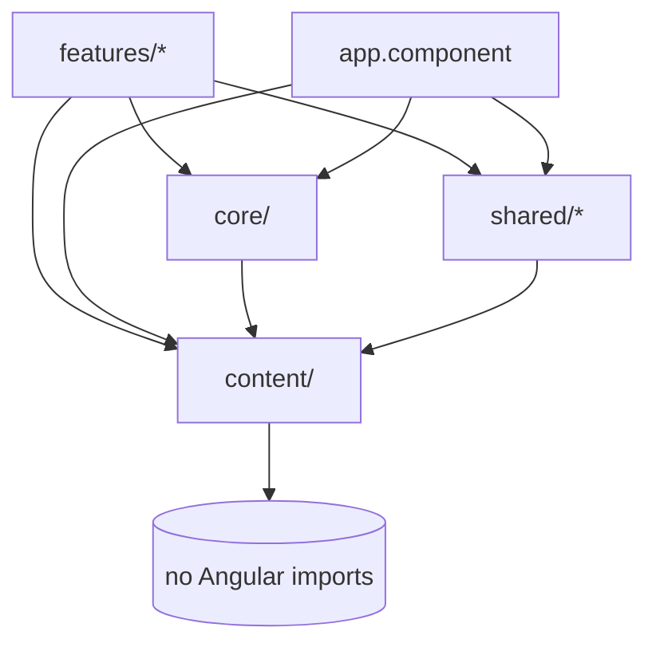
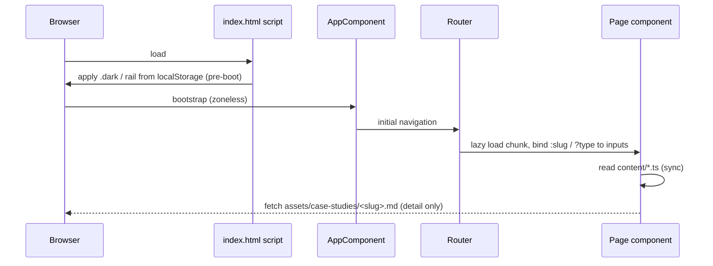

# Architecture

> Status: Active · Last updated: 2026-11-18 · Owner: Hai Nguyen

## Summary

| Aspect | Choice | Decision |
|---|---|---|
| Framework | Angular 19, standalone components, signals, zoneless change detection | [ADR-003](adr/ADR-003-content-layer-and-shell.md) |
| Build | `@angular-devkit/build-angular:application` (esbuild), output `dist/` | — |
| Rendering | Client-side SPA; needs host fallback to `index.html` | [deployment.md](../20-operations/deployment.md) |
| UI system | Compact UI kit (`ui-*`) + Plum theme + Tailwind v3 for layout | [ADR-002](adr/ADR-002-compact-ui-kit.md) |
| Content | Typed TS modules in `src/app/content/` + Markdown case studies | [ADR-003](adr/ADR-003-content-layer-and-shell.md) |
| State | Local signals; two root services (theme, layout). No global store | [ADR-003](adr/ADR-003-content-layer-and-shell.md) |
| Routing | Lazy `loadComponent` per page, component input binding, no view transitions | [ADR-004](adr/ADR-004-no-router-view-transitions.md) |

## Source tree

```
src/
├── index.html              Meta, fonts, pre-boot theme script
├── main.ts                 bootstrapApplication(AppComponent, appConfig)
├── styles.scss             Site styles (imports styles/site/*)
├── styles/
│   ├── ui-kit/             VENDORED kit: tokens.css, components.css, tailwind preset + theme-haintp.css (ours)
│   ├── tailwind.css        @tailwind base/components/utilities
│   └── site/               _base, _page (layout blocks), _prose (Markdown), _print
├── environments/           environment.ts / environment.prod.ts (same keys)
├── assets/
│   ├── images/             avatar, portrait, projects/<slug>.(svg|jpg|webp)
│   ├── logos/              Technology logos (brand colors)
│   └── case-studies/       <slug>.md
└── app/
    ├── app.component.*     Shell: ui-shell, ui-sidenav, top bar, router-outlet
    ├── app.config.ts       Providers
    ├── app.routes.ts       Routes, titles, legacy redirects
    ├── content/            SSoT for page text: types, profile, projects, resume, skills, period helpers
    ├── core/               Root services: ThemeService, LayoutService, PageTitleStrategy
    ├── shared/             Reusable UI: icon/ (IconComponent + paths)
    └── features/           One folder per page: about, portfolio, resume, contact, not-found
```

Path aliases (`tsconfig.json`): `@content`, `@core/*`, `@shared/*`, `@environment`.

## Layers and allowed dependencies



| Layer | May import | Must not import |
|---|---|---|
| `content/` | Nothing except its own files | Angular, RxJS, features, core |
| `core/` | Angular, `content/` | `features/` |
| `shared/` | Angular, `content/` (types) | `features/`, `core/` |
| `features/<x>/` | `content`, `core`, `shared`, own folder; `portfolio/project-card` may be reused by `about` | Another feature's internals (except `project-card`) |

## Runtime flow



## Styling stack (load order is a contract)

| # | File | Role |
|---|---|---|
| 1 | `styles/ui-kit/tokens.css` | `--theme-*` defaults → `--ui-*` semantic tokens |
| 2 | `styles/ui-kit/theme-haintp.css` | Brand inputs (the only file with hex colors) |
| 3 | `styles/ui-kit/components.css` | `.ui-*` controls |
| 4 | `styles/tailwind.css` | Preflight + utilities (utilities beat kit by order) |
| 5 | `styles.scss` | Site blocks: `.page`, `.panel-*`, `.tag`, `.pill`, `.stat`, `.prose`, print |

## Refactoring constraints

- Keep the layer rules above; a new layer needs an ADR.
- Do not re-introduce `BaseComponent`, a global state store, or Angular Material without an ADR.
- Do not edit `tokens.css` / `components.css` locally — change the upstream kit, then re-copy (see [dependency-management.md](../10-engineering/dependency-management.md)).
- Keep every route lazy and titled; keep legacy redirects.

## Cross-references

- [api-contracts.md](api-contracts.md) · [coding-standards.md](../10-engineering/coding-standards.md) · [non-functional-requirements.md](non-functional-requirements.md)
