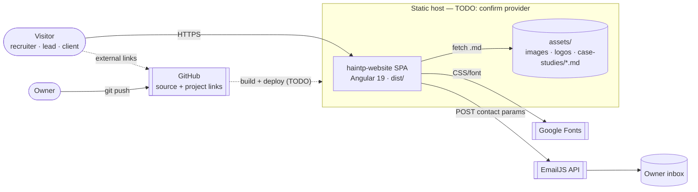

# System Context

> Status: Active · Last updated: 2026-11-18 · Owner: Hai Nguyen

## Context diagram

## Actors

| Actor | Interaction | Trust |
|---|---|---|
| Visitor | Reads pages, sends contact form | Untrusted input (form) |
| Owner | Edits content and code, deploys | Trusted |
| AI agent | Proposes code/doc changes in the repo | Trusted only within [ai-agent-guidelines.md](ai-agent-guidelines.md) |

## External systems

| System | Direction | Data | Failure impact | Fallback |
|---|---|---|---|---|
| EmailJS | Out | Name, email, message, timestamp | Contact form cannot send | Error note + social links on the same page |
| Google Fonts | In | Inter font files | Falls back to system UI font | `--theme-font` stack |
| GitHub | Link only | — | External links broken | None needed |
| Static host | In | Built files | Site down | See [runbook.md](../20-operations/runbook.md) |

## Data handled

| Data | Where | Stored by us? | Notes |
|---|---|---|---|
| Contact form fields | Browser → EmailJS | No | Sent once; no local copy |
| Color mode, sidenav rail | `localStorage` (`haintp.theme`, `haintp.sidenav`) | Browser only | Non-personal preferences |

## Cross-references

- [service-scope.md](service-scope.md) · [api-contracts.md](api-contracts.md) · [security.md](../20-operations/security.md)
